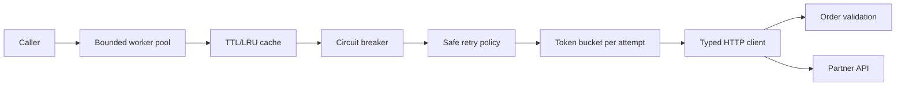
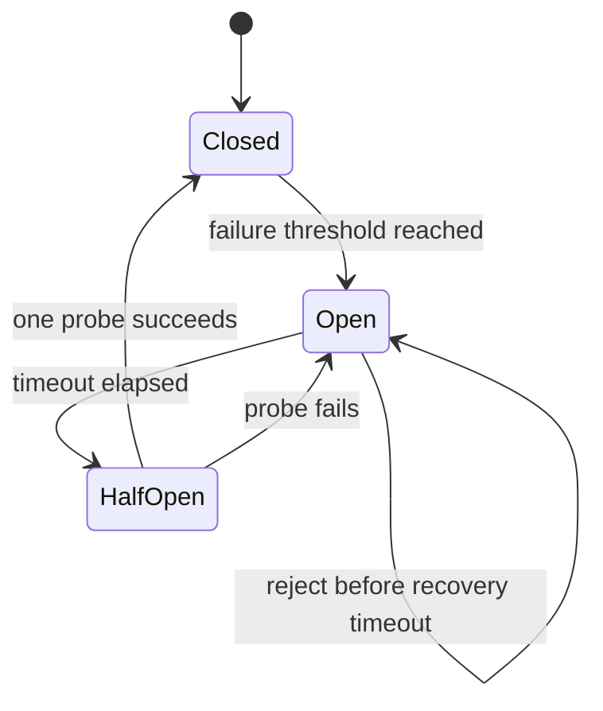
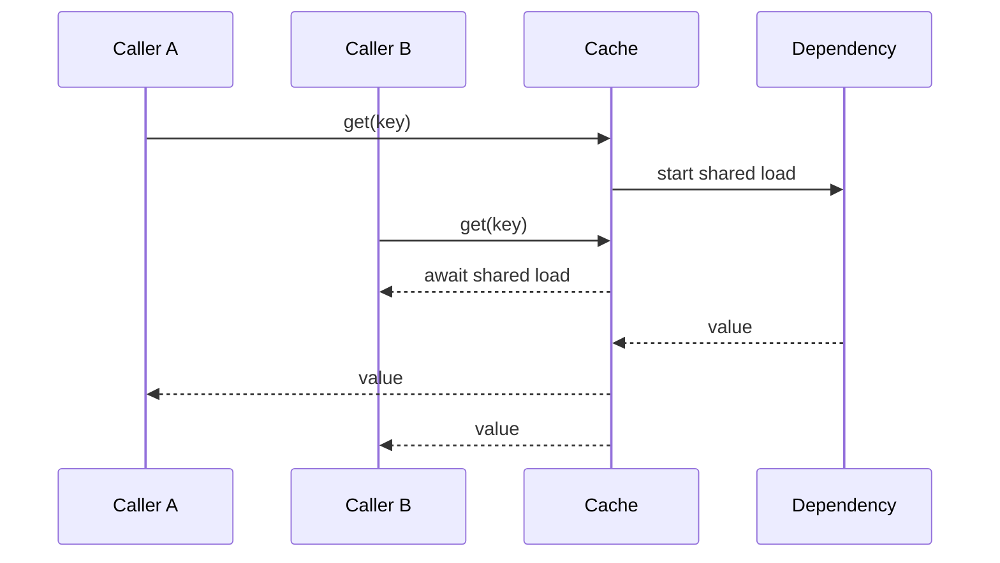

# Architecture and Failure Diagrams

## End-to-end read path



## Why the order matters

```text
cache hit ───────────────────────────────────────────────> return
cache miss -> breaker admission -> logical retry operation
                                  ├─ limiter -> attempt 1
                                  ├─ limiter -> attempt 2
                                  └─ limiter -> attempt 3
final logical outcome -> breaker accounting -> cache/store or stale policy
```

The breaker sees one logical result, while the limiter sees every physical
attempt. Reversing those boundaries either opens the breaker too aggressively or
allows retries to bypass rate control.

## Circuit breaker state machine



## Cache single-flight



## Deadline hierarchy

```text
overall batch deadline
├── worker 1: request timeout -> item failure -> next item
├── worker 2: success -> next item
└── worker 3: still active when batch deadline expires -> cancellation
```

Per-request timeout is an item outcome. Overall timeout stops the workflow and
returns completed and pending context through `BatchDeadlineExceeded`.
